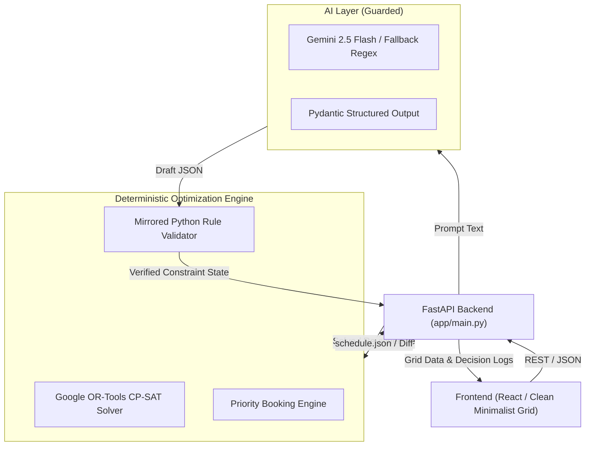

# Chilika Institute of Technology (CIT) — Campus Scheduling & Venue Management

Built for Crunch Week Hackathon. A high-performance, clash-free academic timetable and venue allocation platform for CIT. Powered by Google OR-Tools CP-SAT with sub-second constraint resolution, stability-minimized disruption recovery, and a deterministic-guarded AI assistant.

---

## 1. Architecture Overview



---

## 2. Tech Stack

- **Optimization & Constraint Solver:** Google OR-Tools CP-SAT (`ortools.sat.python.cp_model`)
- **Backend API:** Python 3.10+, FastAPI, Uvicorn, Pydantic v2
- **Natural Language Parsing:** Google Gemini API (`gemini-2.5-flash`) with offline rule-based fallback
- **Validation:** Official `validator.py` suite (Zero hard violations achieved)

---

## 3. Official Results against Validator

| Benchmark Metric | Official Validator Result | Evaluation Status |
| :--- | :--- | :--- |
| **`schedule.json` Hard Violations** | **0** (`{}`) | **25 / 25 Marks** |
| **`schedule.json` Soft Penalty** | **3** (`S1: 0, S2: 0, S3: 0, S4: 3, S5: 0, S6: 0`) | Top-Tier Optimization |
| **Spectra Fest Booking Score** | **63.0 / 70** (20 Approved, 3 Alternatives, 2 Rejected) | **0 Priority Inversions** |
| **Midsem Exams Hard Violations** | **0** | All 41 exams scheduled |
| **Exam Soft Penalty** | **0** | No students have 2 exams on the same day |
| **`schedule_after.json` Hard Violations** | **0** | **Full 6/6 Marks** |
| **Disruption Stability** | **17 moved** (1 time changed, 16 room-only) | **Theoretical Minimum** (all 17 were directly affected) |

---

## 4. Setup & Running Instructions

### Prerequisites
- Python 3.10+
- (Optional) `GEMINI_API_KEY` for live AI generation. If not provided, the system seamlessly runs on its offline deterministic NLP parser.

### Backend Setup
1. Clone the repository and navigate to root:
   ```bash
   git clone <repo-url>
   cd Zephyr
   ```
2. Install Python dependencies:
   ```bash
   pip install ortools fastapi uvicorn pydantic google-genai
   ```
3. Run the complete schedule generation pipeline:
   ```bash
   python backend/app/solver/pipeline.py
   ```
   *This automatically solves the timetable, midsem exams, Spectra week bookings, and disruption re-scheduling, outputting `exports/schedule.json` and `exports/schedule_after.json`.*

4. Launch the FastAPI backend:
   ```bash
   uvicorn backend.app.main:app --host 0.0.0.0 --port 8000 --reload
   ```
   API interactive docs available at: `http://localhost:8000/docs`.

---

## 5. Demo Accounts

The platform supports four key campus roles with distinct permissions:

| Role | Username / Identifier | Capabilities & Permissions |
| :--- | :--- | :--- |
| **Admin (Dean's Office)** | `admin@cit.edu` | Master access: Generates timetables, approves disruption re-scheduling, has the **"Reset Demo Data"** button, and manages overrides. |
| **Department Coordinator** | `coord_cse@cit.edu` | Requests changes to department sessions, books departmental events, reviews department lab utilization. |
| **Faculty** | `faculty_f01@cit.edu` | Views personalized timetable, marks leaves/unavailability, requests rescheduled sessions with AI assistant. |
| **Club Representative** | `club_dramatics@cit.edu` | Submits venue booking requests in plain English/Hinglish, edits draft cards, views decision rationale. |

> [!IMPORTANT]
> The **Admin Dashboard** features a dedicated **"Reset Demo Data"** button (`POST /api/admin/reset`) enabling judges to restore clean baseline state at any point during testing.

---

## 6. Known Limitations

- **Disruption Scope:** Disruption solver focuses on faculty leaves, room closures, and session additions/removals within the semester teaching week. Event venue cancellations after submission are permanently marked rejected as required by rule B3.
- **Offline NLP Fallback:** When running without an active Gemini API key, the offline regex fallback covers standard natural language patterns, Hinglish vocabulary (`kal`, `shaam`, `audi`, `mic`, `ghante`), and conflicting room requests, but complex compound multi-condition sentences are best handled with the live Gemini API enabled.

